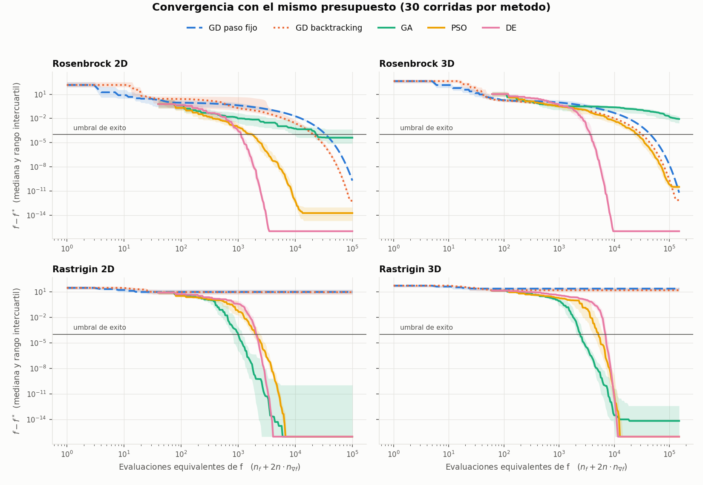
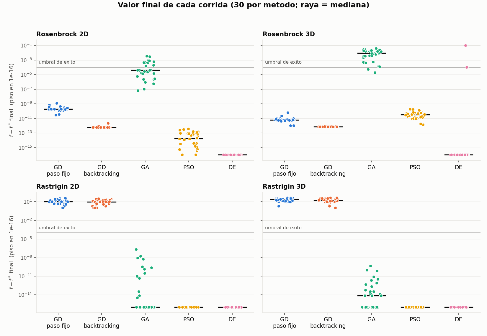
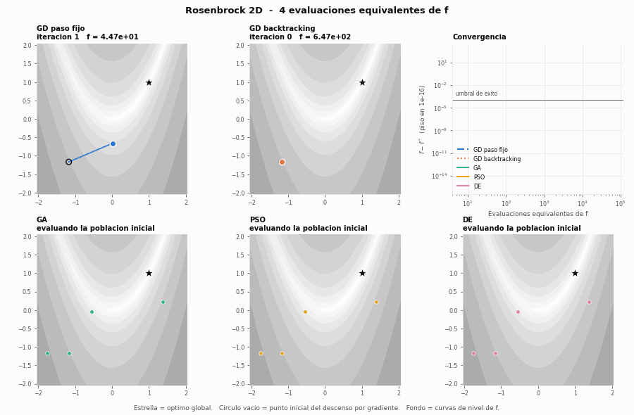
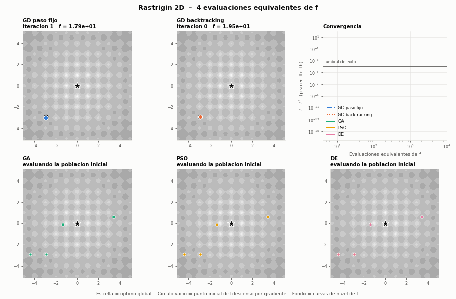

# Parte 1 — Optimización numérica: descenso por gradiente frente a métodos heurísticos

Redes Neuronales y Algoritmos Bioinspirados (3009150), semestre 2026-02.

**Resultado en una frase.** El descenso por gradiente fue el más fiable y preciso cuando había un solo mínimo (Rosenbrock: 100 % de éxito), pero el más caro por el mal condicionamiento, y no encontró el mínimo global de Rastrigin en ninguna de las 30 corridas. Los heurísticos PSO y evolución diferencial encontraron el mínimo global de Rastrigin en todas las corridas y, en Rosenbrock, cruzaron el umbral con menos evaluaciones que el gradiente. Pero no dan garantías: la evolución diferencial falló 2 de 30 corridas en Rosenbrock 3D y el algoritmo genético casi todas.



## 1. Funciones elegidas: Rosenbrock y Rastrigin

| Función | ¿Definida en 2D y 3D? | Geometría | Decisión |
|---|---|---|---|
| **Rosenbrock** | Sí, cualquier *n* | Un solo mínimo para *n* = 2 y 3 (Kok y Sandrock, 2009), en el fondo de un valle curvo y estrecho: mal condicionada | **Elegida** |
| **Rastrigin** | Sí, cualquier *n* | 11ⁿ mínimos locales en una rejilla regular; cada cuenca es casi perfectamente redonda: bien condicionada | **Elegida** |
| Schwefel | Sí | Multimodal, con el óptimo global cerca del borde del dominio | Descartada: mezcla el efecto de los mínimos locales con el del borde |
| Griewank | Sí | Multimodal, con mínimos locales poco profundos | Descartada: repite la historia de Rastrigin con menos contraste |
| Goldstein-Price | No, solo 2D | — | Descartada: no permite el caso 3D |
| Seis jorobas de camello | No, solo 2D | — | Descartada: no permite el caso 3D |

Son las dos más fáciles de trabajar porque se escriben igual en cualquier dimensión, tienen gradiente analítico de una línea y óptimo conocido (*f*\* = 0). Y son la pareja más útil para la discusión porque cada una aísla una dificultad distinta:

| | Rosenbrock | Rastrigin |
|---|---|---|
| Fórmula | Σ [100 (xᵢ₊₁ − xᵢ²)² + (1 − xᵢ)²] | 10 n + Σ [xᵢ² − 10 cos(2π xᵢ)] |
| Dominio *D* | [−2.048, 2.048]ⁿ | [−5.12, 5.12]ⁿ |
| Mínimo global | x\* = (1, …, 1) | x\* = (0, …, 0) |
| Mínimos locales en *D* | 1 | 121 (2D), 1 331 (3D) |
| Número de condición κ en el óptimo | 2 508 (2D), 2 950 (3D) | ≈ 1 |
| Dificultad que aísla | Condicionamiento | Multimodalidad |

Los valores de κ de Rosenbrock se calcularon con los valores propios de la Hessiana en x\*. En Rastrigin la Hessiana es diagonal y en cada mínimo local todas sus entradas valen cerca de 2 + 40π² ≈ 397, así que κ ≈ 1.

## 2. Métodos

Todos resuelven min *f*(x) sujeto a x ∈ *D*. Los parámetros están en [config.yaml](config.yaml).

| Método | Archivo | Configuración |
|---|---|---|
| Descenso por gradiente, paso fijo | [descenso_gradiente.py](descenso_gradiente.py) | α = 10⁻³ (Rosenbrock), α = 2.5·10⁻³ (Rastrigin) |
| Descenso por gradiente, backtracking | [descenso_gradiente.py](descenso_gradiente.py) | Armijo con c₁ = 10⁻⁴, β = 0.5, paso máximo 1 |
| Algoritmo genético (codificación real) | [ga_continuo.py](ga_continuo.py) | Torneo de 3, cruce BLX-0.5 (p = 0.9), mutación gaussiana (p = 0.2 por gen, σ = 10 % del ancho de *D*), élite del 10 % |
| Enjambre de partículas (PSO, gbest) | [pso.py](pso.py) | w = 0.729, c₁ = c₂ = 1.494 (constricción de Clerc y Kennedy), v_max = 0.5 (x_max − x_min)/2 |
| Evolución diferencial (DE/rand/1/bin) | [evolucion_diferencial.py](evolucion_diferencial.py) | F = 0.5, CR = 0.9 |

- **Punto inicial.** El descenso por gradiente parte de un x₀ uniforme en *D*. Los heurísticos parten de una población uniforme en *D* de 20·n individuos (40 en 2D, 60 en 3D).
- **Paso fijo.** Se usó α ≈ 1/L, con L la mayor curvatura: L ≈ 1 002 en el óptimo de Rosenbrock 2D y L = 2 + 40π² ≈ 397 en Rastrigin.
- **Dominio.** Todos los métodos se mantienen dentro de *D*. El descenso por gradiente proyecta cada iterado sobre *D*; los heurísticos recortan al borde.
- **Gradientes.** Son analíticos. Se verificaron contra diferencias centrales en 200 puntos aleatorios por función y dimensión, con error relativo máximo de 5·10⁻¹⁰.

## 3. Regla de comparación justa

**Qué se cuenta.** La clase `Problema` ([funciones.py](funciones.py)) cuenta por separado cada evaluación de *f* y cada evaluación de ∇*f*.

| Método | Evaluaciones por iteración |
|---|---|
| GD paso fijo | 1 de ∇*f*, 0 de *f* |
| GD backtracking | 1 de ∇*f* + 1 de *f* por cada paso de prueba (entre 2.0 y 2.3 pasos de prueba por iteración en estos experimentos) |
| GA | 1 de *f* por hijo; la élite no se reevalúa |
| PSO, DE | 1 de *f* por individuo |

No se cuentan las evaluaciones que no usa el algoritmo: la de *f* en cada iterado del paso fijo (solo sirve para dibujar la curva) y la malla de fondo de los GIF.

**Equivalencia propuesta.**

> evaluaciones equivalentes = n_f + 2n · n_∇f

Una evaluación de ∇*f* se cobra como 2n evaluaciones de *f*, que es lo que cuesta aproximarla por diferencias centrales en dimensión *n*. La justificación es que así los dos tipos de método quedan en el mismo régimen de información: los heurísticos tratan a *f* como caja negra, y un descenso por gradiente sobre una caja negra tendría que pagar ese precio.

Es una equivalencia deliberadamente desfavorable para el gradiente. Aquí el gradiente analítico cuesta más o menos lo mismo que una evaluación de *f*, y con diferenciación automática en modo inverso costaría un múltiplo pequeño de *f* que no crece con *n* (Griewank y Walther, 2008). Por eso la tabla reporta las dos cuentas por separado y la discusión revisa qué cambia con la equivalencia más favorable (1 gradiente = 1 evaluación).

**Protocolo.**

- **Presupuesto común:** 50 000·n evaluaciones equivalentes por corrida (100 000 en 2D, 150 000 en 3D). Equivale a 25 000 iteraciones de paso fijo en ambas dimensiones.
- **Parada:** cada método se detiene por su propio criterio o al agotar el presupuesto. El gradiente para cuando ‖∇*f*‖ < 10⁻⁶. Los heurísticos paran cuando el mejor valor no mejora más de 10⁻¹⁰ durante 100 generaciones seguidas.
- **Corridas:** 30 corridas independientes por configuración (2 funciones × 2 dimensiones × 5 métodos). La corrida *r* usa la misma semilla en todos los métodos, así que los tres heurísticos comparten población inicial y los dos descensos comparten x₀.
- **Éxito:** una corrida es exitosa si *f*(x_final) − *f*\* ≤ 10⁻⁴. En Rastrigin cualquier umbral por debajo de 0.995 (el valor del mejor mínimo local no global) identifica la cuenca global. En Rosenbrock, 10⁻⁴ obliga a estar a menos de unos 0.02 del óptimo a lo largo del valle.

## 4. Resultados

Media, desviación estándar, mejor y peor se refieren a *f*(x_final) − *f*\* sobre las 30 corridas. Las tres columnas de evaluaciones son promedios de lo que gastó cada corrida hasta detenerse. La última columna es la mediana, entre las corridas exitosas, de las evaluaciones equivalentes gastadas al cruzar el umbral por primera vez.

| Función | n | Método | Media | Desv. est. | Mejor | Peor | Éxito (%) | Eval. f | Eval. ∇f | Eval. equiv. | Eval. equiv. hasta el umbral |
|---|---|---|---|---|---|---|---|---|---|---|---|
| Rosenbrock | 2 | GD paso fijo | 2.47e-10 | 2.17e-10 | 2.92e-11 | 1.20e-09 | 100.0 | 0 | 25 000 | 100 000 | 34 276 |
| Rosenbrock | 2 | GD backtracking | 6.75e-13 | 3.04e-13 | 5.94e-13 | 2.25e-12 | 100.0 | 30 238 | 15 115 | 90 698 | 20 808 |
| Rosenbrock | 2 | GA | 3.88e-04 | 8.49e-04 | 6.40e-08 | 3.61e-03 | 63.3 | 21 344 | 0 | 21 344 | 10 480 |
| Rosenbrock | 2 | PSO | 6.90e-14 | 9.65e-14 | 1.25e-17 | 3.63e-13 | 100.0 | 11 853 | 0 | 11 853 | 1 780 |
| Rosenbrock | 2 | DE | 2.56e-30 | 4.64e-30 | 0.00e+00 | 1.60e-29 | 100.0 | 6 339 | 0 | 6 339 | 1 120 |
| Rosenbrock | 3 | GD paso fijo | 8.57e-12 | 1.09e-11 | 1.05e-12 | 6.32e-11 | 100.0 | 0 | 24 906 | 149 437 | 45 306 |
| Rosenbrock | 3 | GD backtracking | 7.33e-13 | 1.32e-14 | 7.11e-13 | 7.55e-13 | 100.0 | 32 853 | 16 422 | 131 387 | 32 102 |
| Rosenbrock | 3 | GA | 1.13e-02 | 1.05e-02 | 1.90e-05 | 3.92e-02 | 6.7 | 149 964 | 0 | 149 964 | 94 668 |
| Rosenbrock | 3 | PSO | 4.63e-11 | 4.70e-11 | 1.39e-12 | 1.96e-10 | 100.0 | 96 330 | 0 | 96 330 | 26 010 |
| Rosenbrock | 3 | DE | 3.43e-03 | 1.88e-02 | 5.24e-25 | 1.03e-01 | 93.3 | 15 246 | 0 | 15 246 | 3 660 |
| Rastrigin | 2 | GD paso fijo | 1.42e+01 | 9.98e+00 | 9.95e-01 | 4.08e+01 | 0.0 | 0 | 8 | 31 | - |
| Rastrigin | 2 | GD backtracking | 1.15e+01 | 8.82e+00 | 9.95e-01 | 3.18e+01 | 0.0 | 72 | 32 | 198 | - |
| Rastrigin | 2 | GA | 8.39e-09 | 3.89e-08 | 0.00e+00 | 2.14e-07 | 100.0 | 6 232 | 0 | 6 232 | 994 |
| Rastrigin | 2 | PSO | 0.00e+00 | 0.00e+00 | 0.00e+00 | 0.00e+00 | 100.0 | 8 931 | 0 | 8 931 | 2 100 |
| Rastrigin | 2 | DE | 0.00e+00 | 0.00e+00 | 0.00e+00 | 0.00e+00 | 100.0 | 7 252 | 0 | 7 252 | 2 120 |
| Rastrigin | 3 | GD paso fijo | 2.36e+01 | 1.18e+01 | 1.99e+00 | 4.48e+01 | 0.0 | 0 | 8 | 50 | - |
| Rastrigin | 3 | GD backtracking | 2.08e+01 | 1.29e+01 | 9.95e-01 | 4.28e+01 | 0.0 | 73 | 32 | 268 | - |
| Rastrigin | 3 | GA | 2.25e-11 | 9.03e-11 | 0.00e+00 | 4.86e-10 | 100.0 | 13 166 | 0 | 13 166 | 2 436 |
| Rastrigin | 3 | PSO | 0.00e+00 | 0.00e+00 | 0.00e+00 | 0.00e+00 | 100.0 | 15 796 | 0 | 15 796 | 5 010 |
| Rastrigin | 3 | DE | 0.00e+00 | 0.00e+00 | 0.00e+00 | 0.00e+00 | 100.0 | 15 466 | 0 | 15 466 | 6 900 |

Para los heurísticos, la columna «Eval. f» incluye las 100 generaciones de espera del criterio de parada. La última columna es la medida más limpia de eficiencia.



**Animaciones (2D).** Cada GIF muestra los cinco métodos avanzando al mismo ritmo de evaluaciones equivalentes, con los cuadros espaciados en escala logarítmica. Se anima la corrida 0, sin escogerla.





## 5. Discusión

### Rosenbrock: un solo mínimo, mal condicionado

**Qué aportó el gradiente: fiabilidad y precisión.** Los dos descensos llegaron al óptimo en las 30 corridas, en 2D y en 3D, con valores finales entre 10⁻¹³ y 10⁻⁹ y muy poca dispersión. Con un solo mínimo, la garantía teórica de converger a un punto crítico es suficiente: el punto crítico es la solución.

**Qué le costó: el condicionamiento.** Con κ ≈ 2 500, la teoría predice que el paso fijo reduce *f* en un factor (1 − αμ)² por iteración, con μ ≈ 0.4 el menor valor propio de la Hessiana. Eso son 2 885 iteraciones por cada factor de 10. En la corrida 0 se midieron 2 875. El gradiente avanza a pasos diminutos por el fondo del valle, como se ve en el GIF, y necesitó una mediana de 34 276 evaluaciones equivalentes para cruzar el umbral en 2D y 45 306 en 3D. El backtracking, que adapta el paso a la curvatura local, lo redujo a 20 808 y 32 102.

**Qué aportaron los heurísticos: velocidad sin gradiente, pero no todos.**

- **DE** cruzó el umbral con 1 120 evaluaciones en 2D y 3 660 en 3D: 31 y 12 veces menos que el paso fijo. La explicación habitual es que sus mutaciones son diferencias entre individuos: cuando la población se alinea con el valle, los pasos también lo hacen, lo que equivale a un precondicionamiento que el gradiente no tiene.
- **PSO** fue 19 veces más barato que el paso fijo en 2D (1 780), pero en 3D necesitó 26 010: solo 1.7 veces menos.
- **GA** fue el peor: 63 % de éxito en 2D y 7 % en 3D. El cruce y la mutación actúan coordenada a coordenada con una escala fija, y eso no sirve para seguir un valle curvo y estrecho.
- **Sin garantías:** DE falló 2 de 30 corridas en 3D porque se estancó antes de llegar: una terminó en 0.10 y la otra en 1.05·10⁻⁴, apenas por encima del umbral.

**Sensibilidad a la equivalencia.** Si un gradiente se cobrara como una sola evaluación de *f*, el paso fijo cruzaría el umbral con 8 569 evaluaciones en 2D y 7 551 en 3D. DE seguiría ganando en ambas dimensiones, pero el gradiente pasaría a ganarle a PSO en 3D. La ventaja de PSO en 3D depende de la equivalencia elegida; la de DE no.

### Rastrigin: muchas cuencas, cada una bien condicionada

**Qué aportó el gradiente: convergencia local casi instantánea.** Cada cuenca es redonda (κ ≈ 1), así que el paso α = 1/L se comporta casi como un paso de Newton: el paso fijo convergió con 8 evaluaciones de gradiente en promedio. Pero convergió al mínimo local de la cuenca donde cayó x₀: 0 de 30 éxitos en 2D y en 3D, con valores finales entre 1 y 45.

**Por qué falla: la cuenca global es una fracción mínima del dominio.** Cada cuenca ocupa cerca de 1/10.24 del ancho de *D* por coordenada, así que la probabilidad de empezar en la correcta es (1/10.24)ⁿ: 0.95 % en 2D y 0.09 % en 3D. Se midió con 10 000 corridas adicionales de paso fijo ([resultados/cuenca_rastrigin.csv](resultados/cuenca_rastrigin.csv)) y coincide: 0.94 % y 0.09 %.

**Qué aportaron los heurísticos: exploración global.** GA, PSO y DE encontraron el mínimo global en las 30 corridas, en 2D y en 3D, cruzando el umbral con entre 994 y 6 900 evaluaciones. PSO y DE terminaron en *f* = 0 exacto; GA quedó entre 10⁻¹¹ y 10⁻⁸ en promedio, por su mutación de escala fija. Aquí GA fue el más rápido: la rejilla de mínimos está alineada con los ejes y sus operadores coordenada a coordenada la aprovechan.

**¿Y si el gradiente reiniciara desde otro punto?** Estimación a partir de la probabilidad medida: el costo esperado es el costo de una corrida dividido por la probabilidad de éxito.

| | Costo por corrida de GD paso fijo | Probabilidad de éxito | Costo esperado con reinicios | Heurísticos (mediana hasta el umbral) |
|---|---|---|---|---|
| Rastrigin 2D | 32 | 0.94 % | ≈ 3 400 | 994 a 2 120 |
| Rastrigin 3D | 51 | 0.09 % | ≈ 57 000 | 2 436 a 6 900 |

En 2D el gradiente con reinicios sería del mismo orden que los heurísticos. Pero su costo se multiplica por unas 17 al pasar a 3D, porque el número de cuencas crece como 11ⁿ, mientras que el de los heurísticos se multiplicó por 2.4 a 3.3. La cifra de 3D es aproximada: sale de solo 9 éxitos en 10 000 corridas.

### Síntesis

| | Descenso por gradiente | Heurísticos (PSO, DE) |
|---|---|---|
| Valor final con un solo mínimo | Óptimo en 30/30, dispersión mínima | Óptimo casi siempre; DE falló 2/30 en 3D |
| Valor final con muchos mínimos | Un mínimo local (0/30) | Óptimo global en 30/30 |
| Evaluaciones con buen condicionamiento | Mínimas (8 gradientes) | Miles |
| Evaluaciones con mal condicionamiento | Decenas de miles: crece con κ | DE poco sensible; PSO sensible en 3D |
| Garantía | Converge a un punto crítico | Ninguna |

- **El gradiente aporta** convergencia local garantizada, precisa y, si la cuenca está bien condicionada, casi gratuita. Sus dos límites son los que predice la teoría: el número de iteraciones crece con κ y no hay ningún mecanismo para salir de la cuenca inicial.
- **Los heurísticos aportan** exploración global sin necesidad de derivadas. La pagan con miles de evaluaciones aun en problemas fáciles, con hiperparámetros que ajustar y sin garantía de éxito.
- **Son complementarios.** Lo que le falta a cada uno es lo que le sobra al otro: un heurístico para encontrar la cuenca correcta y un descenso por gradiente para refinar dentro de ella.

### Limitaciones

- Los hiperparámetros de los heurísticos son valores estándar de la literatura, iguales para las dos funciones; no se sintonizaron. El mal resultado de GA en Rosenbrock corresponde a esta configuración, no a los algoritmos genéticos en general.
- La paciencia del criterio de parada (100 generaciones) se fijó con una prueba piloto: con 50, una corrida de DE en Rastrigin 3D se detenía cuando todavía estaba mejorando.
- El backtracking arranca con paso máximo 1, así que sus primeros pasos pueden ser largos y cruzar el dominio, como se ve en el GIF de Rosenbrock. En Rastrigin eso le da algo más de probabilidad de caer en la cuenca global (1.6 % frente a 0.94 % en 2D), sin cambiar la conclusión.
- Solo se probaron 2 y 3 dimensiones. Las tendencias con la dimensión son indicios, no leyes de escalamiento.

## 6. Cómo reproducir

```
pip install -r requirements.txt
python main.py
```

Tarda unos dos minutos y medio y regenera todo el contenido de `resultados/`. Los resultados son deterministas: dependen solo de `semilla` en [config.yaml](config.yaml).

| Archivo | Contenido |
|---|---|
| [main.py](main.py) | Punto de entrada: corre todo y guarda tablas, figuras y GIF |
| [config.yaml](config.yaml) | Todos los parámetros del experimento |
| [funciones.py](funciones.py) | Rosenbrock, Rastrigin, sus gradientes y el contador de evaluaciones |
| [descenso_gradiente.py](descenso_gradiente.py) | Descenso por gradiente con paso fijo y con backtracking |
| [ga_continuo.py](ga_continuo.py), [pso.py](pso.py), [evolucion_diferencial.py](evolucion_diferencial.py) | Los tres heurísticos |
| [experimentos.py](experimentos.py) | Protocolo de 30 corridas, estadísticas y estimación de la cuenca global |
| [visualizacion.py](visualizacion.py) | Figuras y animaciones |
| `resultados/corridas.csv` | Una fila por corrida (600 en total) |
| `resultados/estadisticas.csv` | Estadísticas por configuración |

## Referencias

1. Ospina Arango, J. D. y Zapata Rincón, A. M. (2026). *Notas introductorias a la optimización numérica de funciones de valor real*. Notas de clase.
2. Ospina Arango, J. D. y Zapata Rincón, A. M. (2026). *Optimización por enjambre de partículas (PSO)*. Diapositivas de clase.
3. Clerc, M. y Kennedy, J. (2002). The particle swarm: explosion, stability, and convergence in a multidimensional complex space. *IEEE Transactions on Evolutionary Computation*, 6(1), 58–73.
4. Eshelman, L. J. y Schaffer, J. D. (1993). Real-coded genetic algorithms and interval-schemata. *Foundations of Genetic Algorithms 2*, 187–202.
5. Griewank, A. y Walther, A. (2008). *Evaluating Derivatives: Principles and Techniques of Algorithmic Differentiation*, 2.ª ed. SIAM.
6. Kok, S. y Sandrock, C. (2009). Locating and characterizing the stationary points of the extended Rosenbrock function. *Evolutionary Computation*, 17(3), 437–453.
7. Storn, R. y Price, K. (1997). Differential evolution: a simple and efficient heuristic for global optimization over continuous spaces. *Journal of Global Optimization*, 11, 341–359.
